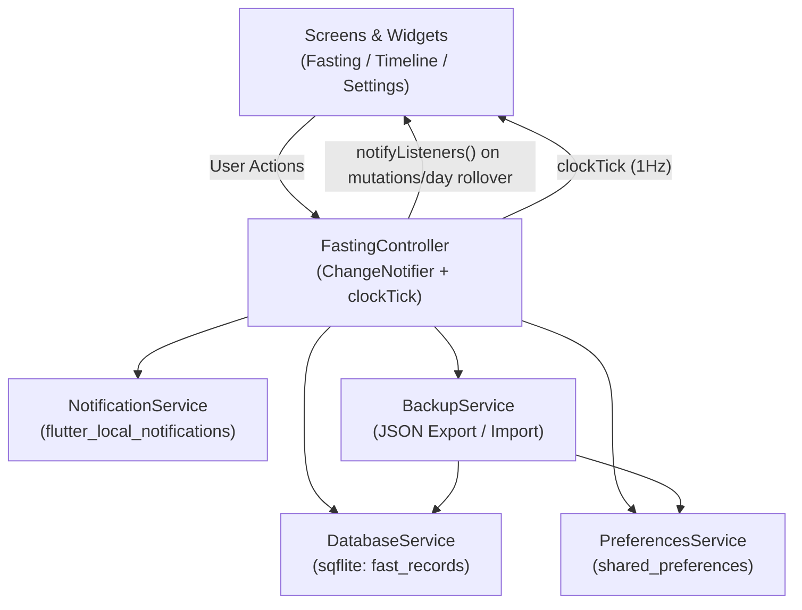

# Fast O'Clock — System Architecture

Offline-first, local-only intermittent fasting tracker built with Flutter.

---

## 1. Architectural Invariants

1. **Zero-Network / Local-Only**: No remote APIs, accounts, telemetry, or ads. All state lives on-device in SQLite (`sqflite`) and `SharedPreferences`.
2. **Timestamp-Driven Timer**: No background isolates or foreground services for timekeeping. Elapsed and remaining durations are pure functions of `nowUtc - startTimeUtc` evaluated on UI ticks (`Timer.periodic(1s)` while foregrounded) and lifecycle resume (`AppLifecycleState.resumed`).
3. **UTC Storage, Local Presentation**: Every persisted timestamp is stored in UTC epoch milliseconds (`INTEGER`). Conversion to local time occurs strictly at UI formatting, calendar-day streak grouping, and local notification scheduling boundaries.
4. **Single Source of Truth for Fasts**: Active and completed fasts reside in the same SQLite `fast_records` table. At most one row may have `end_time_ms IS NULL` at any point in time.

---

## 2. Workspace & Directory Structure

The Flutter project lives at the repository root (`/Volumes/Dev/lab/fast-o-clock/`).

```text
/Volumes/Dev/lab/fast-o-clock/
├── design/                           # Architecture & design specifications
│   ├── ARCHITECTURE.md
│   ├── DATA_MODEL.md
│   └── UI_SPEC.md
├── PLAN.md
├── pubspec.yaml
├── lib/
│   ├── main.dart                     # App bootstrap, DB/Prefs/Notification init
│   ├── app.dart                      # MaterialApp, dynamic_color/theme binding, adaptive shell
│   ├── models/
│   │   ├── fast_record.dart          # FastRecord entity + computed duration/goal helpers
│   │   ├── fast_protocol.dart        # Presets (14:10..36h) + Custom protocol definition
│   │   ├── metabolic_stage.dart      # 6 elapsed-hour metabolic thresholds & copy
│   │   ├── timeline_summary.dart     # Pure single-pass TimelineSnapshot, KPIs, buckets & rows
│   │   └── app_settings.dart         # Typed settings model
│   ├── services/
│   │   ├── database_service.dart     # sqflite setup, migrations, CRUD, overlap & 4h min validation
│   │   ├── preferences_service.dart  # shared_preferences wrapper for AppSettings
│   │   ├── notification_service.dart # flutter_local_notifications + timezone scheduling
│   │   └── backup_service.dart       # Versioned JSON export, debug sample month & import (Merge / Replace)
│   ├── state/
│   │   └── fasting_controller.dart   # ChangeNotifier + decoupled clockTick ValueNotifier
│   ├── screens/
│   │   ├── splash_screen.dart        # Animated launch splash locked to #121417
│   │   ├── onboarding_screen.dart    # Optional first-run intro (gated by isOnboarded)
│   │   ├── fasting_screen.dart       # Tab 1: Timer ring, protocol badge, start/end CTA
│   │   ├── timeline_screen.dart      # Tab 2: Scoped stats, chart, filters & month-grouped history
│   │   └── settings_screen.dart      # Tab 3: Patterns, notifications, theme, backup, about
│   └── widgets/
│       ├── app_brand_title.dart      # "Fast O'Clock" + "time to fast" header component
│       ├── timer_ring.dart           # CustomPainter circular progress gauge
│       ├── metabolic_badge.dart      # Current stage pill + detail bottom sheet
│       ├── protocol_picker.dart      # Preset & custom duration selector sheet
│       ├── tumbler_date_time_picker.dart # Custom wheel date/time picker
│       ├── timeline_chart.dart       # CustomPainter interactive DurationBarChart
│       └── fast_editor_sheet.dart    # Start/End/Mood/Note editor with live validation
└── test/
    ├── models/
    │   ├── metabolic_stage_test.dart
    │   └── timeline_summary_test.dart
    ├── screens/
    │   ├── splash_screen_test.dart
    │   └── timeline_screen_test.dart
    ├── services/
    │   ├── database_service_test.dart
    │   └── backup_service_test.dart
    ├── state/
    │   └── fasting_controller_test.dart
    └── widgets/
        └── fast_editor_sheet_test.dart
```

---

## 3. Component & State Flow



### `FastingController` Responsibilities
- Holds in-memory cache of:
  - `FastRecord? activeFast`
  - `List<FastRecord> history` (completed fasts ordered by `start_time_ms DESC`)
  - `AppSettings settings`
  - Monotonic `int historyVersion` (incremented on `_reloadRecords()`)
  - `ValueListenable<DateTime> clockTick` (decoupled 1 Hz clock notifier)
- Runs a `1s` periodic ticker **only** while `activeFast != null` and app is in foreground, updating `clockTick` (consumed solely by `FastingScreen`) without calling `notifyListeners()` every second. Calls `notifyListeners()` on ticker or `AppLifecycleState.resumed` **only** when `localDayKey` rolls over at local midnight.
- `FastOClockApp` and `TimelineScreen` use `Selector` on primitive/versioned slices (`isInitialized`, `isOnboarded`, `flutterThemeMode`, `historyVersion`, `activeFast?.id`, `localDayKey`, `targetDurationMin`) so they perform zero rebuilds/second during active fasts.
- `TimelineSnapshot` is computed in one $O(N)$ pass and memoized in `TimelineScreen` against version, active ID, local day, target duration, selected range, and selected filter.
- Listens to `WidgetsBindingObserver.didChangeAppLifecycleState`: pauses UI ticker when backgrounded, immediately refreshes `clockTick` on resume, and triggers `notifyListeners()` if the local calendar day changed.

---

## 4. Notification Lifecycle

Notification IDs are deterministic constants:
- `1001`: **Goal Reached** (`"Fasting Goal Reached!"`)
- `1002`: **Eating Window Ending** (`"Eating Window Ending Soon"`)

OS notification permissions are requested on onboarding completion (`completeOnboarding`) when `notifyGoalReached` or `notifyEatingWindow` is enabled, as well as when toggling either switch ON in Settings.

| User / System Event | Notification ID `1001` (Goal Reached) | Notification ID `1002` (Eating Window Ending) |
|---|---|---|
| **Start Fast** (`start + target > now`) | Cancel `1001`; schedule at `start + target` (if `notifyGoalReached` enabled). | Cancel `1002`. |
| **Edit Active Fast** (`start` or `target` changed) | Cancel `1001`; reschedule at new `start + target` if still in the future. | Cancelled. |
| **End Fast** (completed at `endTime`) | Cancel `1001`. | If `notifyEatingWindow` enabled **AND** protocol target `< 24h` (1440m), schedule **15 minutes before** eating window ends (`eatingWindowMin > 15 ? eatingWindowMin - 15 : eatingWindowMin`) if in the future; otherwise cancel `1002`. |
| **Toggle Eating Window ON / Change Default Protocol (idle)** | Unchanged. | Reschedule `1002` from `lastCompletedFast.endTimeMs` if `< 24h` protocol and in the future. |
| **Delete / Cancel Active Fast** | Cancel `1001`. | Cancel `1002`. |
| **Toggle Notification Setting Off** | Cancel `1001` immediately if Goal toggle disabled. | Cancel `1002` immediately if Eating Window toggle disabled. |

---

## 5. Dependency Matrix

| Package | Purpose | Notes |
|---|---|---|
| `sqflite` | Local SQLite database for `fast_records` | Core history & active fast persistence |
| `path` | Joining database file path | Standard companion to `sqflite` |
| `shared_preferences` | Lightweight key-value settings | Theme, default protocol, onboarding, notification toggles |
| `provider` | Dependency injection & `ChangeNotifierProvider` | Exposes `FastingController` to widget tree |
| `flutter_local_notifications` | Scheduled OS notifications | Android exact/inexact alarms & iOS UNUserNotificationCenter |
| `timezone` | `TZDateTime` scheduling for local notifications | Required by `flutter_local_notifications` |
| `intl` | Date, time, and duration formatting | Locale-aware date headers & timestamps |
| `share_plus` / `file_picker` | Exporting and importing backup `.json` files | Native OS share sheet & document picker |
| `dynamic_color` | Android Material You dynamic `ColorScheme` | Applied when non-monochrome (`saturation >= 0.08`), else falls back to `#FF8A00` / `#121417` |
| `sqflite_common_ffi` (dev) | Running SQLite unit tests on host machine | `dev_dependencies` only |

- **Bundled Fonts**: `Lexend` for display/headline/title/label typography and `IBMPlexSans` for body text (`assets/fonts/`).
- **Debug Tooling**: `BackupService.exportSampleMonthBackupJson` generates a 30-day synthetic backup JSON (accessible from `SettingsScreen` only when `kDebugMode == true`).
- **Record IDs**: Generated as 128-bit random hex strings using `dart:math` `Random.secure()`—no external `uuid` package needed.
