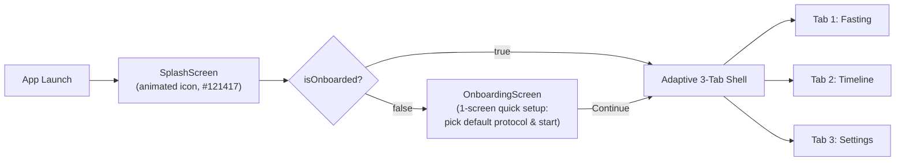

# Fast O'Clock — UI & Interaction Specification

Adaptive 3-tab shell, screen states, custom widgets, and interaction flows.

---

## 1. Brand & Theme Identity

- **App Name**: `Fast O'Clock` (`com.neurral.fast_oclock`)
- **Tagline**: *time to fast — a simple fasting tracker for beginners and pros alike*
- **Typography**: `Lexend` for display/headline/title/label styles; `IBMPlexSans` for body text.
- **Theme Policy**: Dark-first Material 3 theme (`ThemeMode.dark` by default) with `Light` and `System` options. Supports Android Material You `DynamicColorBuilder` when non-monochrome (`HSLColor.fromColor(scheme.primary).saturation >= 0.08`), otherwise falls back to the `#FF8A00` / `#121417` default palette. `SplashScreen` remains locked to `#121417`.
- **Semantic Color Tokens**:
  - **Active Fast / Progress Arc**: Warm Amber / Coral gradient (`#FF8A00` → `#FF5252`)
  - **Goal Reached / Completed**: Emerald Green (`#00C853`)
  - **Early End / Below Goal**: Warm Amber (`#FF8A00`) — unified across Timeline chart and record cards
  - **Surface (Dark)**: Deep Charcoal (`#121417`) with elevated cards (`#1C1F24`)

---

## 2. Adaptive Navigation Shell (`app.dart`)



- **Compact Layout (`width < 600dp`)**: Bottom `NavigationBar` with 3 destinations (`Fasting`, `Timeline`, `Settings`).
- **Expanded Layout (`width >= 600dp`)**: Side `NavigationRail` + centered content container for tablet/desktop ergonomics.

---

## 3. Screen Specifications

### 3.1 Tab 1 — `FastingScreen`

```text
+---------------------------------------+
|             Fast O'Clock              |
|             time to fast              |
|                                       |
|           . - ~ ~ ~ - .               |
|       . '   Goal: 16 hours ' .        |
|     /         14:22:09        \       |
|    |    Elapsed  <->  Remaining |     |
|     \       [Ketosis 12h-18h]  /      |
|       .                       .       |
|         ' - . _ _ _ . - '             |
|                                       |
|  Started 14 hrs ago                   |
|  8:00 PM               NOV 23 • MON   |
|  Target End in 1 hr                   |
|  12:00 PM              NOV 24 • TUE   |
|                                       |
|  [16:8 Preset]   [     End Fast     ] |
+---------------------------------------+
```

#### Three Operational States
1. **Idle (No Active Fast)**:
   - Top displays `AppBrandTitle` (`Fast O'Clock` + `time to fast`).
   - Center `TimerRing` displays `restaurant_rounded` icon, smart status (`"Ready to Fast?"` when `lastCompletedFast == null`, `target >= 24h`, or within 1h / past eating window; else `"Your time to eat"`), and `"Goal: XX hours"` (singular/plural + mins for custom).
   - Above bottom action row: tappable `"Last fast ended XX ago"` pill (jumps to `TimelineScreen` with `focusedRecordId = lastFast.id`).
   - Bottom row: `[Protocol Preset]` chip on left + **Begin Fast** primary button on right.
2. **Fasting — In Progress (`elapsed < target`)**:
   - Animated circular arc (`TimerRing`) fills proportionally from `0.0` to `1.0` in Amber/Coral (or Cool Cyan/Blue in Countdown mode).
   - Center displays `Goal: XX hours`, tabular `HH:MM:SS`, tappable `Elapsed <-> Remaining` toggle, and current **Metabolic Stage badge** (tappable to view all 6 stages).
   - Below ring: tappable **Started** and **Target End** card (`HH:MM PM` left, `MMM DD • WKDAY` all-caps right, pencil icon / flag icon) opening `Edit Ongoing Fast` sheet.
   - Bottom row: `[Protocol Preset]` chip + **End Fast** CTA (opens `FastEditorSheet` in `completeActive` mode).
3. **Fasting — Goal Reached (`elapsed >= target`)**:
   - Ring arc turns **Emerald Green** at 100% with `+Xh Ym past goal` pill and green flag icon on Target End.
   - Primary CTA highlighted in green: **Fast Complete?**.

---

### 3.2 Tab 2 — `TimelineScreen`

```text
+---------------------------------------------+
| Timeline                      [+ Log Fast]  |
+---------------------------------------------+
|       ( 7D )   |   30D   |   All            |
+---------------------------------------------+
|  🔥 1d Streak (Best 12d)   ✅ 73% Met (22/30)|
|  ⏱ 13h 39m Avg             🏆 18h 12m Best  |
+---------------------------------------------+
|20h |                                        |  <- Full-width edge-to-edge chart
|16h |- - - - - - - - - - - - - Default 16h - |
|    |   █     ▄     █     █     ▆     ○    · |
|    |  W 18  T 19  F 20  S 21  S 22  M 23 T24|
|      [Mon, Nov 23 · 16h 26m / 16h · Edit]   |
+---------------------------------------------+
| (All 30) (Goal Met 22) (Early 8) (Notes 9)  |
+---------------------------------------------+
|  NOVEMBER 2026      24 fasts · 75% · 14h10m |
| +-----------------------------------------+ |
| |▎ NOV 23 • MON • 11:07 AM   [16:8] +26m  | |
| |▎ 16h 26m [Ketosis] from 6:41 PM 😐 Okay | |
| |▎ ████████████████████████████████       | |
| +-----------------------------------------+ |
+---------------------------------------------+
```

1. **Compact Header**: `Timeline` title left + `+ Log Fast` `FilledButton.tonalIcon` right (no floating action button overlapping bottom cards).
2. **Range Selector (`7D` | `30D` | `All`)**: Scopes the `Goal Met %`, `Average`, `Longest` KPIs, chart, filter chip counts, and history list. Defaults to `30D` when `history.length > 7`, else `7D`. `Streak (Best Xd)` stays **global (all-time)** regardless of selected range.
3. **Compact 2×2 KPI Strip + Full-Width Edge-to-Edge `DurationBarChart`**:
   - Chart sits in its own full-bleed section (`0` outer horizontal padding, `124dp` height) with overlaid left Y-axis badges (`10h`, `20h`), dashed **`Default <Xh>`** reference line painted above bars, Emerald (`#00C853`) Goal Met bars, Amber (`#FF8A00`) Ended Early bars, primary-outlined Active bar, and muted baseline dots for empty days.
   - `7D` / `30D` plot one bar per local calendar day using the day's best/longest single fast (without summing multi-fast days).
   - `All` plots up to 12 weekly-average buckets (read-only on tap).
   - Tapping a daily bar shows an inset inline readout pill (`Mon, Nov 23 · 16h 26m / 16h · Goal Met`); tapping the readout opens `FastEditorSheet` directly.
4. **Filter Chips & Empty State**:
   - Horizontally scrollable `ChoiceChip` row (`All`, `Goal Met`, `Ended Early`, `Notes` with range-scoped counts).
   - When `history.isNotEmpty` and the active range or filter matches 0 fasts, displays `"No fasts in this period"` / `"No fasts match this filter"` with a `"Show All"` reset action.
5. **Month-Grouped History List (`SliverList.builder`)**:
   - Displays range-scoped history filtered by the active chip, grouped under compact month headers (`NOVEMBER 2026` + `count · % met · avg`).
   - **Compact Record Row (~96–112dp)**:
     - 4dp left status rail (`#00C853` Goal Met / `#FF8A00` Ended Early).
     - Top row: `MMM d • EEE` all-caps smaller + `•` + larger bold end time (`NOV 23 • MON • 11:07 AM`), protocol pill (`16:8`), and goal delta (`+26m` / `-3h 17m`).
     - Middle row: bold tabular duration (`16h 26m`), metabolic stage pill (`Ketosis`, `Autophagy`, etc.), `from <start time>`, and **distinct mood icon + tint** (`Great`, `Okay`, `Challenging`, `Bad`).
     - Optional note preview (up to 2 lines, shown only when note exists).
     - Bottom 3dp goal progress hairline (`0%..100%`).
   - Scroll offset preserved via `PageStorageKey('timeline_scroll')`.
   - `focusedRecordId` (from `FastingScreen` `"Last fast ended"` pill) auto-clears conflicting filter/range if needed, scrolls to the target card, pulses a brief highlight border, and clears via `onFocusedRecordHandled`.
   - **Tap Card**: Opens `FastEditorSheet` (`editPast`) to edit or delete record (with confirmation dialog).

---

### 3.3 Tab 3 — `SettingsScreen`

Grouped into clean list sections:
1. **Fasting Preferences**:
   - `Fasting Patterns` selector (`ProtocolPicker`)
2. **Notifications**:
   - `Fasting Goal Reached` switch
   - `Eating Window Ending` switch (`"Reminds you to start your next fast for protocols under 24h"`)
3. **Appearance**:
   - Theme segmented control (`Dark` / `Light` / `System`)
4. **Data & Family Backup**:
   - `Export Backup to your Files` — triggers OS share/save sheet
   - `Import Backup from your Files` — picks `.json` file, prompts **Merge (Recommended)** vs. **Replace All**, displays result snackbar
   - `Export Sample Month (Debug)` — visible only when `kDebugMode == true`
5. **About**:
   - `Fast O'Clock` version (`v1.0.0`), slogan (*time to fast — a simple fasting tracker for beginners and pros alike.*), privacy statement (*"100% offline. Your data never leaves your device."*), dynamic copyright (`© YEAR. neurral and pinoy.dev`).

---

## 4. Modal Bottom Sheets & Validation UX

### `FastEditorSheet` (`editActiveStart`, `completeActive`, `editPast`, `addPast`)
- **`editActiveStart` (`Edit Ongoing Fast`)**: Displays inline `TumblerDateTimePicker` for start time, live overlap/future validation, and bottom `[Delete | Save]` row.
- **`completeActive` (`Break your fast:`)**: Protocol chip, compact Start/End panels (End Time opens `TumblerDateTimePicker`), goal-met encouragement banner, mood chips (`Great!`, `Okay`, `Challenging`, `Bad`), optional `Note` (max 280 chars), and bottom `[Delete | Save to Timeline]` row.
- **`editPast` / `addPast`**: Protocol list tile (`ProtocolPicker`), Start/End `ListTile`s opening `TumblerDateTimePicker`, mood chips, optional `Note`, live validation banner (including 4-hour minimum duration and SQLite overlap check), and **Save** CTA (with header trash icon in `editPast`).
