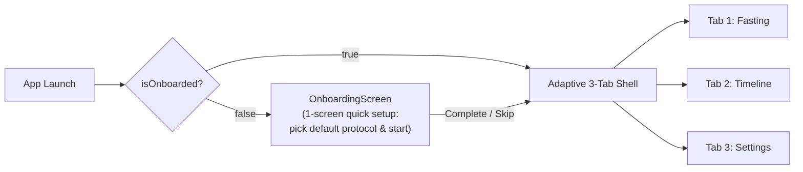

# Fast O'Clock — UI & Interaction Specification

Adaptive 3-tab shell, screen states, custom widgets, and interaction flows.

---

## 1. Brand & Theme Identity

- **App Name**: `Fast O'Clock` (`com.neurral.fast_oclock`)
- **Tagline**: *time to fast — a simple fasting tracker for beginners and pros alike*
- **Theme Policy**: Dark-first Material 3 theme (`ThemeMode.dark` by default) with `Light` and `System` options.
- **Semantic Color Tokens**:
  - **Active Fast / Progress Arc**: Warm Amber / Coral gradient (`#FF8A00` → `#FF5252`)
  - **Goal Reached / Completed**: Emerald Green (`#00C853`)
  - **Early End / Below Goal**: Muted Slate / Amber (`#90A4AE`)
  - **Surface (Dark)**: Deep Charcoal (`#121417`) with elevated cards (`#1C1F24`)

---

## 2. Adaptive Navigation Shell (`app.dart`)



- **Compact Layout (`width < 600dp`)**: Bottom `NavigationBar` with 3 destinations (`Fasting`, `Timeline`, `Settings`).
- **Expanded Layout (`width >= 600dp`)**: Side `NavigationRail` + centered content container (max width `640dp`) for tablet/desktop ergonomics.

---

## 3. Screen Specifications

### 3.1 Tab 1 — `FastingScreen`

```text
+---------------------------------------+
|  Fast O'Clock          [16:8 Preset v]|
|                                       |
|           . - ~ ~ ~ - .               |
|       . '   [Autophagy] ' .           |
|     /       Elapsed (tap)   \         |
|    |        14:22:09         |        |
|     \       Goal: 16h 00m   /         |
|       .                   .           |
|         ' - . _ _ _ . - '             |
|                                       |
|  Started: Yesterday, 8:00 PM [Edit]   |
|  Target:  Today, 12:00 PM             |
|                                       |
|  [            End Fast             ]  |
+---------------------------------------+
```

#### Three Operational States
1. **Idle (No Active Fast)**:
   - Protocol chip at top is tappable to switch presets (`14:10`, `16:8`, `18:6`, `20:4`, `23:1`, `36h`, `Custom`).
   - Ring displays empty track + selected protocol duration (e.g., `16 hours`) + time since last completed fast.
   - Primary CTA: **Start Fast** (creates active `FastRecord` with `startTimeMs = now` or user-picked past start time).
2. **Fasting — In Progress (`elapsed < target`)**:
   - Animated circular arc (`TimerRing`) fills proportionally from `0.0` to `1.0` in Amber/Coral.
   - Center displays current **Metabolic Stage badge** (tappable to view all 5 stages & hour thresholds), **Elapsed / Remaining toggle** (tap timer text to switch), and percentage (`89%`).
   - Below ring: `Started` timestamp with **[Edit]** button, and computed `Target End` timestamp. Protocol chip remains tappable to adjust goal mid-fast.
   - Primary CTA: **End Fast** (opens `FastEditorSheet` pre-filled with `endTime = now`).
3. **Fasting — Goal Reached (`elapsed >= target`)**:
   - Ring arc turns **Emerald Green** at 100% with an subtle over-goal indicator (`+1h 15m past goal`).
   - Primary CTA highlighted: **Complete Fast**.

---

### 3.2 Tab 2 — `TimelineScreen`

1. **Summary Header Card**:
   - **Current Streak** (flame icon + consecutive goal-met days).
   - **Total Fasts** count & **Average Duration** (`16h 12m`).
   - **7-Day Bar**: 7 vertical capsules (`M T W T F S S`) color-coded by status (Emerald = Goal Met, Amber = Completed < Goal, Outlined = Active, Dim = None).
2. **History List**:
   - Grouped by month or chronological cards showing:
     - Local Date & Day of week
     - Protocol badge (`16:8`) + Goal status pill (`Goal Met` / `Ended Early`)
     - Actual duration (`16h 05m`) and start → end timestamps
     - Optional mood icon & note snippet
   - **Tap Card**: Opens `FastEditorSheet` to edit start time, end time, protocol, mood, or note, or **Delete** record (with confirmation dialog).
3. **Floating / Header Action — `+ Add Past Fast`**:
   - Opens `FastEditorSheet` in manual-entry mode for logging forgotten past fasts.

---

### 3.3 Tab 3 — `SettingsScreen`

Grouped into clean list sections:
1. **Fasting Preferences**:
   - Default Protocol selector
2. **Notifications**:
   - `Fasting Goal Reached` switch (requests OS permission on first enable)
   - `Eating Window Ending` switch (subtext: *"Reminds you to start your next fast for protocols under 24h"*)
3. **Appearance**:
   - Theme segmented control (`Dark` / `Light` / `System`)
4. **Data & Family Backup**:
   - `Export Backup (JSON)` — triggers OS share/save sheet
   - `Import Backup (JSON)` — picks `.json` file, prompts **Merge (Recommended)** vs. **Replace All**, displays result snackbar
5. **About**:
   - `Fast O'Clock` version, slogan (*time to fast*), copyright `pinoy.dev`, privacy statement (*"100% offline. Your data never leaves your device."*).

---

## 4. Modal Bottom Sheets & Validation UX

### `FastEditorSheet` (Used for Start Edit, End Fast, Edit Past Fast, Add Past Fast)
- **Fields**:
  - Protocol / Target Duration selector
  - `Start Time` date-time picker
  - `End Time` date-time picker (hidden when editing an active fast's start time)
  - Mood selector row (`Great`, `Good`, `Okay`, `Hard`)
  - Optional `Note` text field (max 280 chars)
- **Live Validation Banner**:
  - Immediately validates on picker change against:
    1. `start < end <= now`
    2. `DatabaseService.findOverlappingRecord(startMs, endMs, excludeId)`
  - If an overlap is detected, displays inline error banner (*"Overlaps with 16:8 fast on Nov 20 (8:00 PM – 12:00 PM)"*) and disables the **Save** button until resolved.
